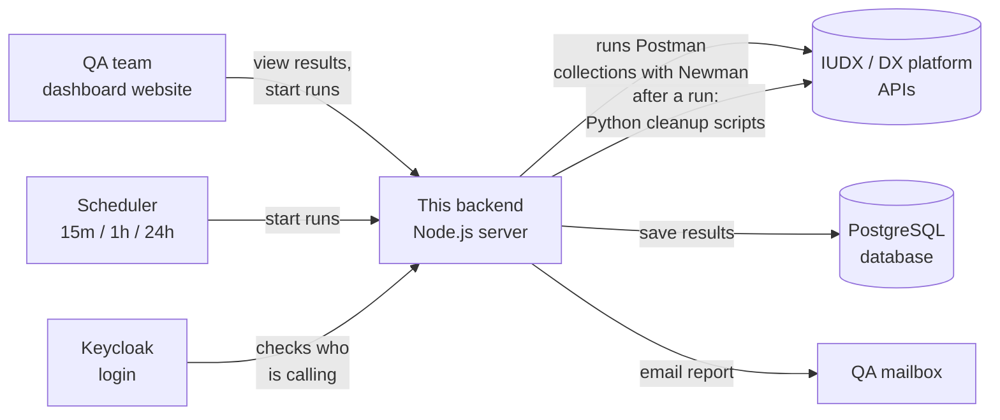
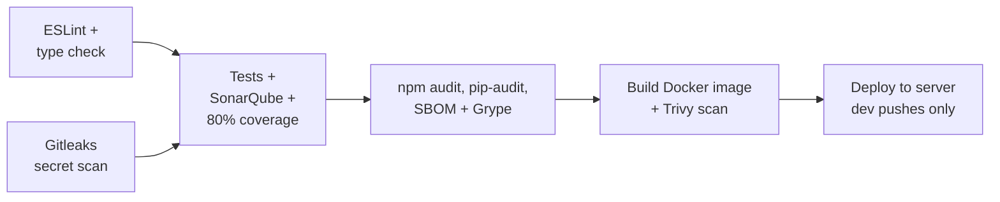

# IUDX QA Backend

An automated testing service for the IUDX / DX platform. It repeatedly checks that the platform's APIs still work, cleans up the test data it creates, records every result, and emails the team a report.

This README is written for everyone. The first sections explain the project in plain language. Later sections cover how it is built, configured, run and deployed.

---

## Contents

1. [What this project does, in plain words](#1-what-this-project-does-in-plain-words)
2. [Words you will see](#2-words-you-will-see)
3. [The big picture](#3-the-big-picture)
4. [What gets tested](#4-what-gets-tested)
5. [What happens during one test run](#5-what-happens-during-one-test-run)
6. [Cleaning up after a run (post-run scripts)](#6-cleaning-up-after-a-run-post-run-scripts)
7. [Automatic re-runs and email reports](#7-automatic-re-runs-and-email-reports)
8. [Who can do what (login and roles)](#8-who-can-do-what-login-and-roles)
9. [Where results are kept](#9-where-results-are-kept)
10. [Passwords and secrets (`.env`)](#10-passwords-and-secrets-env)
11. [Technologies used](#11-technologies-used)
12. [Project structure, folder by folder](#12-project-structure-folder-by-folder)
13. [API endpoints](#13-api-endpoints)
14. [Running it on your computer](#14-running-it-on-your-computer)
15. [Configuration reference](#15-configuration-reference)
16. [Adding or changing a collection](#16-adding-or-changing-a-collection)
17. [Automated tests for this project](#17-automated-tests-for-this-project)
18. [Build, checks and deployment (CI/CD)](#18-build-checks-and-deployment-cicd)
19. [Troubleshooting](#19-troubleshooting)
20. [Leftover files](#20-leftover-files)

---

## 1. What this project does, in plain words

The IUDX / DX platform is a set of online services (Control Plane, Data Plane, File Connect, Sandbox Connect). Other software talks to these services through **APIs**: fixed web addresses that accept a request and send back an answer.

When developers change the platform, something that used to work can quietly break. Checking hundreds of APIs by hand every day is slow and error-prone, so this project does it automatically:

1. **It sends real requests** to the platform, the same way an app or a user would. Examples: "log in as a provider", "create an organisation", "upload a file".
2. **It checks every answer.** Did the request succeed? Is the answer in the right shape? Is the number or name correct?
3. **It cleans up** the test users, organisations and data it created, so the next run starts fresh.
4. **It saves the results** so you can see what passed, what failed and why, including the last few runs of each test suite.
5. **It can repeat all this on a schedule** (every 15 minutes, hourly or daily) and **email a report** to the QA team.

A separate **dashboard website** (the frontend, in its own repository) shows these results as charts and tables. This repository is the **backend**: the engine that runs the tests and serves the results to the dashboard.

---

## 2. Words you will see

| Word | Meaning |
|---|---|
| **API** | A web address a program calls to ask a service to do something or to fetch data. |
| **Request** | One call to an API, e.g. "GET the list of organisations". |
| **Assertion / test** | One check on an answer, e.g. "the status code is 200". A request can have several. |
| **Postman** | A popular tool for writing and saving API requests. The test suites here are Postman files. |
| **Collection** | One Postman file containing a whole suite of requests and checks, e.g. all Control Plane tests. |
| **Environment** | A Postman file of settings for a collection: server addresses, usernames, password placeholders. |
| **Newman** | The command-line engine that runs Postman collections without the Postman app. This server uses it internally. |
| **Run** | One complete pass through a collection. |
| **Post-run cleanup** | Small Python programs that delete the test data a run created. |
| **Keycloak** | The login system used by the platform and by this dashboard. It issues **tokens** (digital passes). |
| **Token** | A long code proving who you are, sent with each request instead of your password. |
| **`.env` file** | A private, never-shared file holding passwords and settings for this server. |
| **Docker** | A way to package the app with everything it needs so it runs the same on any server. |
| **CI/CD** | The automatic checks and deployment that run whenever code is pushed. |

---

## 3. The big picture



In one sentence: **the dashboard or the scheduler asks the backend to run a test suite. The backend runs it against the platform, cleans up, stores the result in the database, and (for scheduled runs) emails a summary.**

---

## 4. What gets tested

Each folder inside [`collections/`](collections/) is one test suite. The server finds them automatically. There is no list to maintain.

| Suite (folder) | Dashboard id | Requests | What it covers | Cleanup after run |
|---|---|---|---|---|
| **Control Plane** | `control-plane` | ~597 | Users, organisations, providers, consumers, access requests and policies, credits, applications. The platform's "admin" side. | Yes, 4 scripts (see [section 6](#6-cleaning-up-after-a-run-post-run-scripts)) |
| **Data Plane** | `data-plane` | ~50 | Reading and searching the actual data (NGSI-LD entities, queries). | No |
| **File Connect** | `file-connect` | ~42 | Uploading, listing and downloading files (assets). | No |
| **Sandbox Connect** | `sandbox-connect` | ~94 | Sandbox bookings and notebook APIs. | No |

Every folder holds exactly **one collection file** (`*.postman_collection.json`) and **one environment file** (`*.postman_environment.json`). Control Plane also has a **`post-run.json`**, which lists the cleanup steps.

---

## 5. What happens during one test run

Here is what happens step by step when someone clicks "Run" on the dashboard (or the scheduler starts a run):

1. **Permission check.** The server confirms the caller is logged in through Keycloak and has the `qa_admin` role.
2. **Queueing.** The run joins a queue. Up to **10 suites run at the same time**. The same suite can't run twice at once (a second request gets "already running").
3. **Loading the files.** The server reads the suite's collection and environment files.
4. **Filling in secrets.** Wherever a file says `${SOMETHING}`, the server fills in the real value from the private `.env` file. If a value is missing, the run stops with a clear message instead of sending a wrong password.
5. **Control Plane only, password memory.** One Control Plane test changes a consumer's password. The server remembers the new password in `data/control-plane-password.json`, so the next run logs in with the right one.
6. **Running the tests.** Newman sends every request in order and checks every answer.
7. **Hiding secrets.** Before anything is saved, passwords, tokens and secret values are replaced with `[REDACTED]`. Login headers keep only their type (e.g. `Bearer [REDACTED]`).
8. **Saving the result.** The pass/fail counts, each request with its answer, timings and errors go into the database. The suite is marked **passed** if every request and check passed, otherwise **failed**.
9. **Cleanup.** If the suite has a `post-run.json`, its cleanup scripts run now (next section). Cleanup problems are logged but **never change the test result**.

If the server is restarted mid-run (e.g. during a deploy), any run left "running" is marked **error** when the server starts again, so it doesn't stay stuck forever.

---

## 6. Cleaning up after a run (post-run scripts)

Testing creates real things on the platform: organisations, users, credit balances, provider requests, data exchanges. If they were never removed, each run would collide with the leftovers of the last one. So after the **Control Plane** suite, four Python scripts tidy up.

They live in [`automation-scripts/`](automation-scripts/) and are listed, in order, in [`collections/Control Plane/post-run.json`](collections/Control%20Plane/post-run.json):

| # | Step name | Script | What it removes, in plain words |
|---|---|---|---|
| 1 | Delete created organisation | [`organisation_deletion.py`](automation-scripts/CONTROLPLANE_Cleanup_Script/organisation_deletion/organisation_deletion.py) | The organisation the test created and approved, its membership rows and the original request. Where the API can't delete it (it refuses while an admin is still attached), the script removes the rows directly in the database. |
| 2 | Clean up compute data | [`compute_credit_cleanup.py`](automation-scripts/CONTROLPLANE_Cleanup_Script/compute_credit_cleanup/compute_credit_cleanup.py) | The test consumer's compute role, credit balance and credit requests, so "grant role / add credits" can be tested again. |
| 3 | Clean up platform provider data | [`platform_provider_cleanup.py`](automation-scripts/CONTROLPLANE_Cleanup_Script/platform_provider_cleanup/platform_provider_cleanup.py) | An approved "become a platform provider" request. The API has no undo for an approval, so the script rolls it back so the request can be made again. |
| 4 | Clean up NGSI-LD data | [`ngsild_delete_v1.py`](automation-scripts/NGSILD_Automation_Script/ngsild_delete_v1.py) | For each data item the run created: its Elasticsearch index (stored documents), its RabbitMQ exchange (message channel) and the RabbitMQ user created for it. |

**How the scripts get their inputs:**
- `post-run.json` has an **`export`** list. It picks values out of the finished run (e.g. the id of the organisation request just created) and hands them to the scripts as `--request-id`, `--exchange`, etc.
- Each script reads its own config file next to it (`*_config.json`, or `config.ini` for NGSI-LD). Those files hold `${VAR}` placeholders for passwords, which are filled from `.env`.

**Useful flags when running a script by hand** (from inside its folder):
- `--help`: shows every option.
- `--dry-run`: shows what it *would* do without changing anything.
- `--inventory-only` (compute / platform provider scripts): only reads and reports.

**The Python environment:** the scripts need two Python libraries, listed in [`collections/Control Plane/requirements.txt`](collections/Control%20Plane/requirements.txt) (`requests` for API calls, `psycopg2` for the database). Locally, the server creates a private Python environment in `.post-run-venvs/` the first time and installs them. In Docker they are pre-installed in the image at `/opt/post-run-venvs/`.

---

## 7. Automatic re-runs and email reports

The dashboard has an **Auto re-run** setting:

| Setting | Meaning |
|---|---|
| **Interval** | `off`, `15m`, `1h` or `24h`: how often to run the suites automatically. Default is `off`. |
| **Collections** | Which suites to include (default: all). |
| **Recipients** | Who gets the email. The default comes from `QA_RECIPIENTS` in `.env`. |

Settings are saved in the database, so they survive restarts.

At each interval the scheduler:
1. Runs the chosen suites. If a suite is already running because someone started it manually, it waits for that run instead of starting another.
2. Sends an email titled **"[IUDX QA] Daily API Automation Test Report"** with totals, pass rate and failed suites, plus links to each suite's full HTML report.
3. If the whole run couldn't happen at all, it sends a **failure alert** email instead.

If the previous scheduled run is still going when the next one is due, the new one is skipped rather than piling up.

`AUTO_RERUN_ON_STARTUP=true` makes the server do one run immediately after it starts, e.g. right after a deploy.

To see what the emails look like without sending one, run `npm run build`, then `node scripts/previewMail.mjs`. It writes example emails to [`previews/`](previews/).

---

## 8. Who can do what (login and roles)

Login uses **Keycloak**. The dashboard signs the user in and sends their token with every request. The backend checks the token's digital signature against Keycloak's public keys, and checks that it hasn't expired and was issued for this app.

| Action | Who can do it |
|---|---|
| Health check (`/`, `/health`, `/healthz`) | Anyone |
| API documentation (`/api/docs`) | Anyone |
| Open an HTML test report (the links in emails) | Anyone with the link |
| View suites, results, history, dashboard numbers, settings | Any logged-in user |
| **Start a run**, **change auto re-run settings** | Logged-in users with the **`qa_admin`** role |

---

## 9. Where results are kept

Results are stored in **PostgreSQL** in two tables:

| Table | What it holds |
|---|---|
| `collection_states` | One row per suite: its current status (idle / running / passed / failed / error), the latest result, and the **last 5 runs** of history. |
| `app_settings` | The auto re-run settings. |

The Control Plane rotated password is kept in a small file, `data/control-plane-password.json` (outside Git, and kept on the server's disk between deploys).

In development, `DB_SYNC=alter` creates and updates the tables automatically. In production that setting is refused, and `DB_SYNC=none` must be used.

---

## 10. Passwords and secrets (`.env`)

**No real password, secret or token is committed to Git.** All of them live in a file called **`.env`** in the project root. Git ignores this file, and so does the Docker build.

The test files only contain **placeholders** like:

```json
{ "key": "provider_pass", "value": "${CP_PROVIDER_PASS}" }
```

At run time the server (for collections) and each Python script (for its config) replaces `${CP_PROVIDER_PASS}` with the value from `.env`. `${NAME:-default}` uses `default` when `NAME` isn't set.

**To set up `.env`:** copy [`.env.example`](.env.example) to `.env` and fill in every value. The example file lists every variable, grouped by suite and script. Important rules:

- **Never commit `.env`.** It's already ignored by Git.
- On the server, write values **without quotes**. Docker's `--env-file` keeps quotes as part of the value.
- **If a variable is missing**, a run stops with *"Environment variable X is not set … Add it to .env."* Add it and run again.
- Some tokens (`DP_CONSUMER_TOKEN`, `SC_NOTEBOOK_ACCESS_TOKEN`, `SC_ROTATED_REFRESH_TOKEN`) aren't renewed by their suites. When they expire, put new ones in `.env`.
- Login tokens for Control Plane and File Connect are blank in the files on purpose. Those suites log in and fill them during the run.

---

## 11. Technologies used

| Technology | What it is | What it does here |
|---|---|---|
| **Node.js 22** | Runs JavaScript/TypeScript on a server | The platform the backend runs on |
| **TypeScript** | JavaScript with type checking | The language of all server code in `src/` |
| **tsx** | Runs TypeScript directly | Starts the server (`npm start`, `npm run dev`) and the tests |
| **Express 5** | Web server framework | Receives HTTP requests and routes them to the right code |
| **Newman** | Postman's command-line runner | Executes the Postman collections |
| **PostgreSQL** | Database | Stores results, history and settings |
| **Sequelize** (+ `pg`) | Database toolkit | Reads and writes the database from TypeScript |
| **Zod** | Data validation | Checks `.env` settings, request inputs and `post-run.json` files |
| **Winston** | Logging | Writes structured logs (JSON in production) |
| **Nodemailer** | Email sending | Sends the scheduled reports over SMTP |
| **Swagger UI** | Interactive API docs | Serves the API reference at `/api/docs` |
| **dotenv** | Reads `.env` | Loads settings and secrets at startup |
| **Keycloak** (external) | Login / identity server | Issues and signs user tokens |
| **Python 3** (+ `requests`, `psycopg2`) | Scripting language | The post-run cleanup scripts |
| **Docker** | Container packaging | Builds and runs the app on the server |
| **GitHub Actions** | CI/CD | Checks, scans and deploys on every push |
| **ESLint, SonarQube, Gitleaks, npm audit, pip-audit, Syft, Grype, Trivy** | Quality and security tools | Run in CI (see [section 18](#18-build-checks-and-deployment-cicd)) |

---

## 12. Project structure, folder by folder

```
iudxqa-backend/
├── src/                     The server's source code (TypeScript)
├── collections/             The Postman test suites, one folder each
├── automation-scripts/      Python cleanup scripts that run after a suite
├── test/                    Automated tests for this server itself
├── scripts/                 One-off developer helper scripts
├── data/                    Runtime files kept on disk (not in Git)
├── previews/                Example report emails (generated)
├── config/                  Old mapping file (unused, see section 20)
├── .github/workflows/       CI/CD pipeline definition
├── Dockerfile               How the server image is built
├── .env.example             Template listing every setting and secret
├── package.json             Node dependencies and npm commands
├── tsconfig.json            TypeScript settings
└── sonar-project.properties SonarQube code-analysis settings
```

### `src/`: the server

| File / folder | What it does |
|---|---|
| [`index.ts`](src/index.ts) | **Starting point.** Loads `.env`, connects to the database, marks interrupted runs, wires everything together and starts the web server and the scheduler. |
| [`app.ts`](src/app.ts) | Builds the web server: CORS rules, health check, request logging, security headers, API docs, public report links, the login requirement, and error handling. |
| [`routes/apiRoutes.ts`](src/routes/apiRoutes.ts) | The list of API addresses and which ones need `qa_admin`. |
| [`controllers/collectionController.ts`](src/controllers/collectionController.ts) | Handles the suite endpoints: list, results, history, dashboard numbers, reports, start runs. |
| [`controllers/settingsController.ts`](src/controllers/settingsController.ts) | Reads and updates the auto re-run settings. |
| [`catalog.ts`](src/catalog.ts) | **Discovers suites.** Scans `collections/`, pairs each folder's collection with its environment, validates `post-run.json`, and lists anything it had to skip and why. |
| [`runner.ts`](src/runner.ts) | **The engine.** Queues runs (max 10 at once), fills `${VAR}` secrets from `.env`, runs Newman, redacts secrets, turns Newman's output into a clean result, keeps the Control Plane password, and runs the post-run scripts in their Python environment. |
| [`scheduler.ts`](src/scheduler.ts) | The auto re-run timer and the report/alert emails. |
| [`mailer.ts`](src/mailer.ts) | Builds the HTML and plain-text emails and sends them via SMTP. |
| [`reportGenerator.ts`](src/reportGenerator.ts) | Builds the detailed HTML report page for a run. |
| [`authentication.ts`](src/authentication.ts) | Verifies Keycloak tokens and checks roles. |
| [`validation.ts`](src/validation.ts) | Validates ids in URLs and request bodies. |
| [`config/env.ts`](src/config/env.ts) | Defines and validates every setting read from `.env`. |
| [`database/`](src/database/) | Database connection and the two table definitions. |
| [`repositories/`](src/repositories/) | Code that saves and loads results (keeping the last 5 runs) and settings. |
| [`store.ts`](src/store.ts), [`types.ts`](src/types.ts) | Shared shapes of data (what a result, a run or a suite looks like). |
| [`docs/openapi.ts`](src/docs/openapi.ts) | The API description shown at `/api/docs`. |
| [`logger.ts`](src/logger.ts), [`formatTime.ts`](src/formatTime.ts) | Logging and India-time (IST) date formatting. |

### `collections/`: the test suites

```
collections/
├── Control Plane/
│   ├── DX_Control_Plane_API.postman_collection.json   the tests
│   ├── contrlplane-evm.postman_environment.json       settings + ${VAR} placeholders
│   ├── post-run.json                                  cleanup steps to run afterwards
│   └── requirements.txt                               Python libraries for those steps
├── Data Plane/        collection + environment
├── File Connect/      collection + environment (+ example.jpg used by upload tests)
└── Sandbox Connect/   collection + environment
```

### `automation-scripts/`: cleanup scripts

```
automation-scripts/
├── CONTROLPLANE_Cleanup_Script/
│   ├── organisation_deletion/       organisation_deletion.py + organisation_deletion_config.json
│   ├── compute_credit_cleanup/      compute_credit_cleanup.py + compute_credit_cleanup_config.json
│   └── platform_provider_cleanup/   platform_provider_cleanup.py + platform_provider_cleanup_config.json
└── NGSILD_Automation_Script/
    ├── ngsild_delete_v1.py
    ├── config.ini                   Kibana / RabbitMQ settings (${VAR} for passwords)
    └── rabbitmq-ca.crt              RabbitMQ certificate (kept with the script)
```

The scripts run with the **Control Plane folder as their working directory**, which is why `post-run.json` refers to them as `../../automation-scripts/...`.

### `test/`: tests for this server

| File | What it checks |
|---|---|
| [`api.test.ts`](test/api.test.ts) | The HTTP API: login rules, roles, responses and errors |
| [`runner.test.ts`](test/runner.test.ts) | A real Newman run against a local fake server; result shaping; secret redaction; `${VAR}` filling |
| [`runManager.test.ts`](test/runManager.test.ts) | Queueing, post-run steps, Control Plane password memory |
| [`units.test.ts`](test/units.test.ts) | Settings validation, time formatting, email content, database stores, scheduler, catalog scanning |
| [`helpers.ts`](test/helpers.ts) | Shared fakes (in-memory database, logger, sample collections) |

### `scripts/`: developer helpers

| File | What it does |
|---|---|
| [`previewMail.mjs`](scripts/previewMail.mjs) | Writes sample report emails to `previews/` so you can see the design. |
| [`generateCollections.js`](scripts/generateCollections.js), [`syncDxDataPlane.js`](scripts/syncDxDataPlane.js), [`syncExactCollections.js`](scripts/syncExactCollections.js), [`syncFilesConnect.js`](scripts/syncFilesConnect.js) | Old one-off generators for the original collections. They write files with older names straight into `collections/`, so **don't run them** on the current layout without updating them first. |

### `data/`: runtime files (not in Git)

| File | Purpose |
|---|---|
| `control-plane-password.json` | The current Control Plane consumer password after rotation. Mounted as a volume on the server so it survives deploys. |
| `results.json` | Left over from before the database. No longer used. |

---

## 13. API endpoints

The full interactive reference is at **`/api/docs`** once the server is running. Summary (all under `/api`):

| Method | Address | Login | What it does |
|---|---|---|---|
| GET | `/auth/me` | user | Who am I, and my roles |
| GET | `/collections` | user | List all suites and their status |
| GET | `/skipped` | user | Files the scanner ignored, and why |
| GET | `/summary` | user | Overall totals |
| GET | `/dashboard` | user | Numbers for the dashboard (KPIs, per-suite) |
| GET | `/collections/:id/result` | user | Latest full result of a suite |
| GET | `/collections/:id/runs/latest` | user | Latest run, summarised |
| GET | `/collections/:id/history` | user | The last 5 runs |
| GET | `/runs/:runId` | user | Status of one run |
| GET | `/collections/:id/report` | public | HTML report of the latest run |
| GET | `/collections/:id/history/:runId/report` | public | HTML report of an older run |
| POST | `/collections/:id/run` | **qa_admin** | Run one suite |
| POST | `/run-selected` | **qa_admin** | Run several suites |
| POST | `/run-all` | **qa_admin** | Run every suite |
| GET | `/settings/auto-rerun` | user | Read auto re-run settings |
| PUT | `/settings/auto-rerun` | **qa_admin** | Change auto re-run settings |

Outside `/api`: `GET /`, `/health` and `/healthz` return `{"status":"healthy"}` for load balancers.

---

## 14. Running it on your computer

**You need:** Node.js 22, Python 3 (for the cleanup scripts), and a PostgreSQL database.

```bash
# 1. Install the Node libraries
npm install

# 2. Create your private settings file and fill it in
cp .env.example .env
#    at minimum: DATABASE_URL, the KEYCLOAK_* values, and the collection secrets

# 3. Start the server (restarts automatically when you edit code)
npm run dev
```

The server listens on `http://localhost:4000` (or your `PORT`). Open `http://localhost:4000/api/docs` to try the API.

Other commands:

| Command | What it does |
|---|---|
| `npm start` | Start without auto-restart |
| `npm test` | Run this project's automated tests |
| `npm run build` | Compile TypeScript into `dist/` (also checks types) |

Running a cleanup script by hand (it reads `.env` values from your shell environment):
```bash
cd "collections/Control Plane"
python ../../automation-scripts/CONTROLPLANE_Cleanup_Script/organisation_deletion/organisation_deletion.py --help
```

---

## 15. Configuration reference

All settings come from `.env` (see [`.env.example`](.env.example) for the full, commented list).

**Server settings**

| Variable | Default | Meaning |
|---|---|---|
| `PORT` | `4000` | Port the server listens on |
| `COLLECTIONS_DIR` | `collections` | Where the test suites are |
| `DATABASE_URL` | (required) | PostgreSQL address, `postgres://user:<password>@host:5432/db` |
| `DB_SYNC` | `alter` | `alter` auto-manages tables (dev only). Use `none` in production. |
| `NODE_ENV` | `development` | `development`, `test` or `production` |
| `CORS_ORIGINS` | localhost:5173 | Comma-separated list of dashboard addresses allowed to call the API |
| `KEYCLOAK_URL`, `KEYCLOAK_REALM` | | Where to verify logins |
| `KEYCLOAK_API_AUDIENCE`, `KEYCLOAK_FRONTEND_CLIENT_ID` | | Which tokens are accepted |
| `SMTP_HOST`, `SMTP_PORT`, `SMTP_USER`, `SMTP_PASS`, `MAIL_FROM` | | Email sending. Without these, no emails go out. |
| `QA_RECIPIENTS` | | Default email recipients (comma-separated) |
| `PUBLIC_API_URL` | `http://localhost:4000` | Used for report links in emails |
| `DASHBOARD_URL` | | Used for the "Back to Dashboard" button in reports |
| `AUTO_RERUN_ON_STARTUP` | `false` | Run everything once right after starting |
| `CONTROL_PLANE_PASSWORD_FILE` | `data/control-plane-password.json` | Where the rotated password is kept |
| `POST_RUN_VENV_ROOT` | (unset) | Set in Docker to use pre-built Python environments |

**Test and cleanup secrets.** Each is used by one or more suites or scripts, as grouped in `.env.example`:

- `COS_ADMIN_PASSWORD`: shared COS admin password
- `CP_*`: Control Plane suite (client secrets, user passwords)
- `DP_*`: Data Plane suite
- `FC_*`: File Connect suite
- `SC_*`: Sandbox Connect suite
- `ORG_DEL_*`, `CP_PG_PASSWORD`, `KC_ADMIN_CLIENT_SECRET`, `CC_TARGET_PASSWORD`, `PP_*`: cleanup scripts
- `NGSILD_*`: NGSI-LD cleanup (Kibana and RabbitMQ)

---

## 16. Adding or changing a collection

**Adding a new suite:**
1. Export the collection and its environment from Postman as JSON (Collection v2.1).
2. Create a new folder in `collections/` named after the suite. The folder name becomes its id (e.g. `My Suite` → `my-suite`).
3. Put **exactly one** collection file and **one** environment file in it.
4. Replace every password, secret or long-lived token with `${SOME_NAME}`, add `SOME_NAME=` to `.env.example`, and put the real value in `.env`.
5. Restart isn't needed: the server re-scans the folder whenever it lists or runs suites. If something is wrong, `GET /api/skipped` says why.

**Adding cleanup to a suite:** add a `post-run.json` next to the collection:

```json
{
  "export": { "org_id": "environment.created_org_id" },
  "python": { "requirements": "requirements.txt" },
  "steps": [
    { "name": "Delete test org", "command": "python",
      "args": ["../../automation-scripts/.../my_cleanup.py", "--org-id", "{{org_id}}"] }
  ]
}
```

- `export` takes values from the finished run (`environment.x` or `collection.x`) and names them for use in steps as `{{name}}`.
- `{{env.x}}` reads environment value `x` directly.
- Steps run in order, from the suite's folder. A failing step is logged and doesn't change the test result.

**Updating an existing suite from Postman:** export it, then **put the `${VAR}` placeholders back** before committing. A fresh export contains real values.

---

## 17. Automated tests for this project

```bash
npm test
```

This runs the whole test suite in `test/` with Node's built-in test runner. The tests use a fake in-memory database and a local fake API server, so **no real platform or database is touched**. CI also checks code coverage (minimum 80%).

---

## 18. Build, checks and deployment (CI/CD)

Defined in [`.github/workflows/deploy.yaml`](.github/workflows/deploy.yaml). It runs on every pull request to `dev` and every push to `dev`. **Only a push to `dev` deploys.**



| Stage | What it checks |
|---|---|
| Lint | Code style (ESLint) and TypeScript types |
| Secrets | Gitleaks looks for passwords committed by mistake (currently report-only) |
| Test and analyze | Runs the tests, sends coverage to SonarQube, fails under 80% coverage |
| Dependency scan | Known vulnerabilities in Node and Python libraries; software bill of materials |
| Image scan | Builds the Docker image and scans it with Trivy |
| Deploy | Connects to the server over SSH, checks out the exact tested commit, builds the image, and restarts the container |

**On the server**, the container is started with:
- `--env-file .env`: the server's own `.env` (not in Git; must be kept up to date by hand)
- `-v ./data:/app/data`: keeps `data/` (the rotated password) between deploys
- `--restart always`: comes back automatically after a crash or reboot

**The Docker image** ([`Dockerfile`](Dockerfile)) contains Node 22, Python 3, the app, and a pre-built Python environment for the cleanup scripts. It removes npm and pip after installing to reduce security-scan findings.

---

## 19. Troubleshooting

| Symptom | Likely cause and fix |
|---|---|
| Run fails immediately: *"Environment variable X is not set"* | `X` is missing from `.env` (or the server's `.env`). Add it and run again. |
| A suite doesn't appear on the dashboard | Check `GET /api/skipped`. Usually the folder doesn't have exactly one collection and one environment, or `post-run.json` is invalid. |
| *"Collection is already running"* | Wait for the current run to finish; each suite runs once at a time. |
| A suite stays "error" after a deploy | It was interrupted by the restart. Run it again. |
| Control Plane logins fail after a failed run | The saved password in `data/control-plane-password.json` may be out of step with the platform. Correct it there (or delete it to fall back to `CP_CONSUMER_PASS`). |
| Cleanup step failed | Check the server logs for "Post-run cleanup failed" or the step's name. Run the script by hand with `--dry-run` to see what it would do. NGSI-LD exits with code `2` for config problems. |
| No emails arrive | `SMTP_*` not set, or no recipients. The log says "Auto re-run email not sent because SMTP or recipients are not configured". |
| 401 / 403 from the API | 401: not logged in or token expired. 403: the user lacks the `qa_admin` role. |
| Data Plane or Sandbox tests fail with auth errors | Their stored tokens expired. Update `DP_CONSUMER_TOKEN` / `SC_*_TOKEN` in `.env`. |

---

## 20. Leftover files

These are not used by the running server and can be removed when convenient:

- `config/mapping.json`: an old file-pairing map. Pairing is now automatic, per folder.
- `data/results.json` and the `RESULTS_FILE` line in the Dockerfile: from before results moved to PostgreSQL.
- `collections/Sandbox Connect/old/`: an empty folder.
- `scripts/generateCollections.js` and `scripts/sync*.js`: see [scripts/](#scripts-developer-helpers) above.
